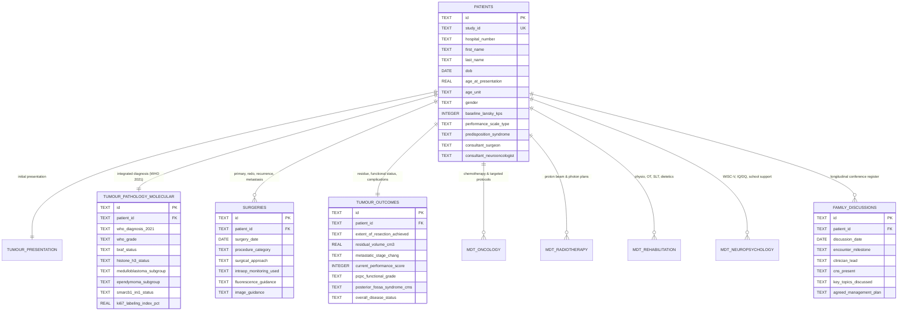

# Multidisciplinary Paediatric Neurosurgical Oncology Database
## Complete Relational Schema Architecture & Clinical Specification

**Conceived, designed and tested: Dr G Narenthiran MB ChB BSc(MedSci)(Hons) MRCS(Ed.) FEBNS FRCS(SN). Copyright 2026, Dr G Narenthiran, g_narenthiran@hotmail.com, all rights reserved.**  
by **Dr G Narenthiran MB ChB BSc(MedSci)(Hons) MRCS(Ed.) FEBNS FRCS(SN)**  
*Dedicated with love and gratitude to Mrs Nirmaladevy Ganesalingam BSc.*

---

## 1. System Overview

The **Multidisciplinary Paediatric Neurosurgical Oncology Database** is an enterprise-grade clinical registry and research platform dedicated exclusively to paediatric central and peripheral nervous system tumours:
- **Paediatric Brain Tumours**: Posterior fossa (Medulloblastoma, Pilocytic Astrocytoma, Ependymoma, ATRT), supratentorial hemispheric and midline/diencephalic tumours (Gliomas, Craniopharyngiomas, Pineal region tumours).
- **Paediatric Spinal Cord Tumours**: Intramedullary (astrocytomas, ependymomas), intradural-extramedullary, and extradural neoplasms.
- **Peripheral Nerve Tumours**: Schwannomas, Neurofibromas, Plexiform Neurofibromas, Malignant Peripheral Nerve Sheath Tumours (MPNST) in neurofibromatosis (NF1/NF2) and sporadic settings.

---

## 2. Relational Entity-Relationship Diagram

---

## 3. Data Tables Specification

### 3.1 `patients` Master Registry
| Field | Type | Description / Constraints |
| :--- | :--- | :--- |
| `id` | `TEXT PRIMARY KEY` | UUIDv4 unique record key |
| `study_id` | `TEXT UNIQUE NOT NULL` | Protocol study ID (e.g. `PEDS-ONC-001`) |
| `hospital_number` | `TEXT` | NHS / Hospital MRN |
| `first_name`, `last_name`| `TEXT` | Patient demographics |
| `dob` | `DATE` | Date of birth |
| `age_at_presentation` | `REAL` | Calculated age at diagnosis |
| `age_unit` | `TEXT` | 'Years' or 'Months' |
| `gender` | `TEXT` | Male, Female, Other, Unknown |
| `baseline_lansky_kps` | `INTEGER` | Baseline functional score (0–100) |
| `performance_scale_type` | `TEXT` | Lansky Play-Performance (<16y) vs Karnofsky (≥16y) |
| `predisposition_syndrome` | `TEXT` | NF1, NF2, Li-Fraumeni, VHL, Gorlin, Tuberous Sclerosis, Turcot, None |
| `consultant_surgeon` | `TEXT` | Lead Paediatric Neurosurgeon |
| `consultant_neurooncologist` | `TEXT` | Lead Paediatric Neuro-Oncologist |
| `consultant_radiotherapist` | `TEXT` | Lead Clinical Oncologist / Radiotherapist |
| `clinical_nurse_specialist` | `TEXT` | Named Neuro-Oncology Key Worker / CNS |

### 3.2 `tumour_presentation`
Structured presenting symptoms across anatomical compartments:
- **Intracranial / Brain**: Morning vomiting, headache, papilloedema, macrocephaly, cranial nerve palsies, ataxia/dysmetria, torticollis, hemiparesis, seizures.
- **Spinal Cord**: Persistent back/neck pain, radicular pain, motor weakness, sensory level, sphincter disturbance, progressive scoliosis.
- **Peripheral Nerve**: Palpable mass, Tinel's sign, paresthesia, focal muscle wasting.

### 3.3 `tumour_pathology_molecular` (WHO CNS 5th Edition 2021)
- Integrated histological & molecular diagnosis.
- WHO CNS Grade: Grade 1, Grade 2, Grade 3, Grade 4.
- **Molecular Biomarkers**:
  - *BRAF* alterations: Wild-type, V600E mutation, KIAA1549-BRAF fusion.
  - *Histone H3* status: H3 K27-altered, H3 G34-mutant, Wild-type.
  - *Medulloblastoma* subgroups: WNT-activated, SHH-activated (*TP53* wildtype vs mutant), Non-WNT/Non-SHH (Group 3, Group 4).
  - *Ependymoma* subgroups: Posterior Fossa PFA, Posterior Fossa PFB, Supratentorial ZFTA-fusion, Supratentorial YAP1-fusion, Spinal myxopapillary / classic.
  - *SMARCB1/INI1* & *SMARCA4*: Loss in ATRT.
  - *CDKN2A/B* homozygous deletion in high-grade astrocytomas.
  - Ki-67 / MIB-1 proliferation labeling index (%).

### 3.4 `surgeries` (Comprehensive Operative Log)
Accommodates primary interventions, repeat resections, and management of recurrence or metastases:
- `procedure_category`:
  - `Primary Surgical Resection`
  - `Primary Biopsy (Stereotactic / Open / Endoscopic)`
  - `Redo Surgery (Second-Look / Planned Residual Clearance)`
  - `Surgery for Recurrent Tumour / Local Relapse`
  - `Surgery for Metastasis (Drop Mets / Distant Seeding)`
  - `CSF Diversion (ETV / VP Shunt / Ommaya Reservoir / EVD)`
- Operative details: lead surgeon, surgical approach, intraoperative neuromonitoring (IONM - MEP/SSEP/cranial nerve EMG), fluorescence guidance (5-ALA / Sodium Fluorescein), intraoperative ultrasound / navigation, operative duration, blood loss, and operative narrative.

### 3.5 `tumour_outcomes` (Oncological & Functional Metrics)
- **Extent of Resection (EOR)**: Gross Total Resection (GTR, 100%), Near Total Resection (NTR, >90%), Subtotal Resection (STR, 50-90%), Partial Resection (PR, <50%), Biopsy Only.
- **Residual Disease**: Presence, residual volume in $ ext{cm}^3$, and precise anatomical location.
- **Chang Metastatic Staging**: M0 (no mets), M1 (CSF cytology positive), M2 (intracranial subarachnoid seeding), M3 (spinal subarachnoid drop metastasis), M4 (extraneural).
- **Functional Status**: Serial Lansky Play-Performance Scale / KPS; Paediatric Cerebral Performance Category (PCPC Grade 1–5); ambulatory status.
- **Complications**:
  - Cerebellar Mutism Syndrome (CMS) / Posterior Fossa Syndrome
  - Postoperative cranial nerve deficits
  - Swallowing dysfunction & gastrostomy (PEG) dependency
  - Hypopituitarism / endocrine axis failure
  - Postoperative hydrocephalus & permanent shunt requirement
  - Pseudomeningocele / CSF leak
  - Radiation necrosis and vasculopathy
- **Disease Status**: Complete Remission (CR), Stable Disease (SD), Partial Response (PR), Progressive Disease (PD).

### 3.6 Multidisciplinary Team Child Tables
- `mdt_oncology`: Chemotherapy protocols (e.g. SIOP Medulloblastoma, HIT, Milan, LGG Carboplatin/Vincristine), targeted inhibitors (Dabrafenib/Trametinib, Larotrectinib, Crizotinib), RANO response criteria, toxicities.
- `mdt_radiotherapy`: Modality (Proton Beam Therapy [PBT], photon VMAT, CyberKnife/SRS), target field (CSI + posterior fossa/ventricular boost, local tumor bed), total dose in Gy, fraction count, completion dates, and radiation toxicities.
- `mdt_rehabilitation`: Longitudinal entries for Physiotherapy (gross motor goals), Occupational Therapy (fine motor & activities of daily living), Speech & Language Therapy (dysphagia and speech), and Dietetics (nutritional support & gastrostomy feeds).
- `mdt_neuropsychology`: Cognitive assessment batteries (WISC-V, WPPSI-IV, Bayley-4), Full-Scale IQ (FSIQ) or Developmental Quotient (DQ), Verbal Comprehension (VCI), Perceptual Reasoning (PRI), Working Memory (WMI), Processing Speed (PSI), Executive Function summary, and Education, Health and Care Plan (EHCP) school support status.

### 3.7 `family_discussions` (Communication & Care Conference Log)
Structured log for sensitive, high-stakes communication across disease milestones:
- `encounter_milestone`:
  - Initial Diagnosis & Prognostic Orientation
  - Pre-Operative Consent & Surgical Risk Discussion
  - Post-Operative Histology & Molecular MDT Debrief
  - Adjuvant Oncology (Chemo / Proton Therapy) Planning
  - Surveillance & Mid-Treatment Progress Review
  - Disease Recurrence / Relapse / Progression Conversation
  - Surgical Redo / Re-operation Discussion
  - Advance Care Planning / Palliative / Parallel Planning
  - Transition to Teen / Adult Oncology Services
- `clinician_lead`, `cns_present`, `family_members_present`
- `key_topics_discussed`, `family_preferences_and_goals`, `agreed_management_plan`, `emotional_support_referrals`
